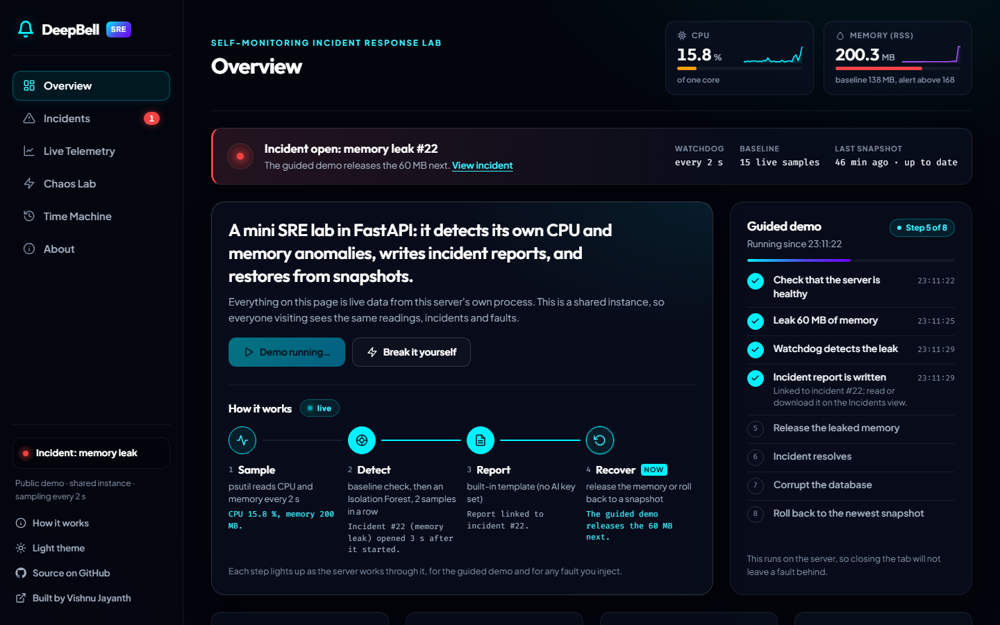
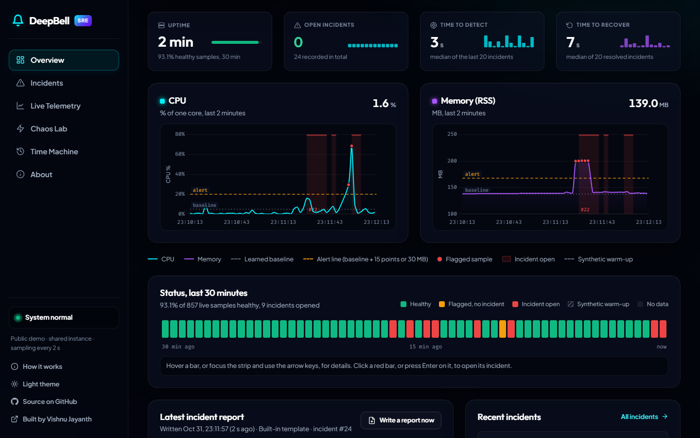
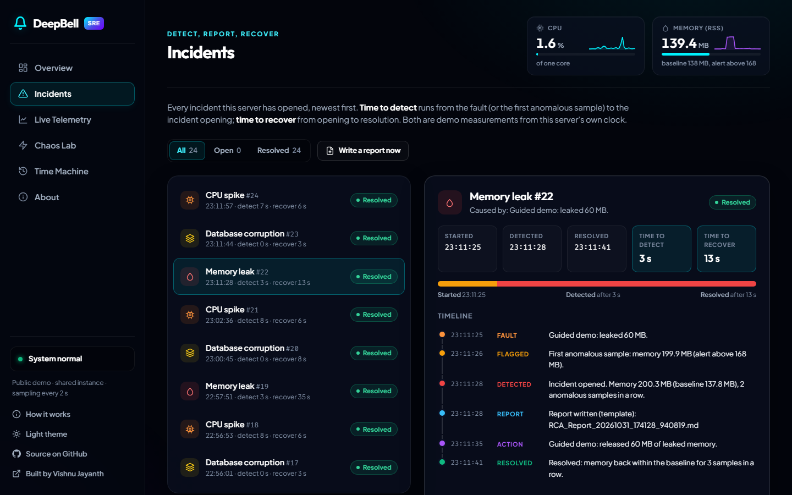
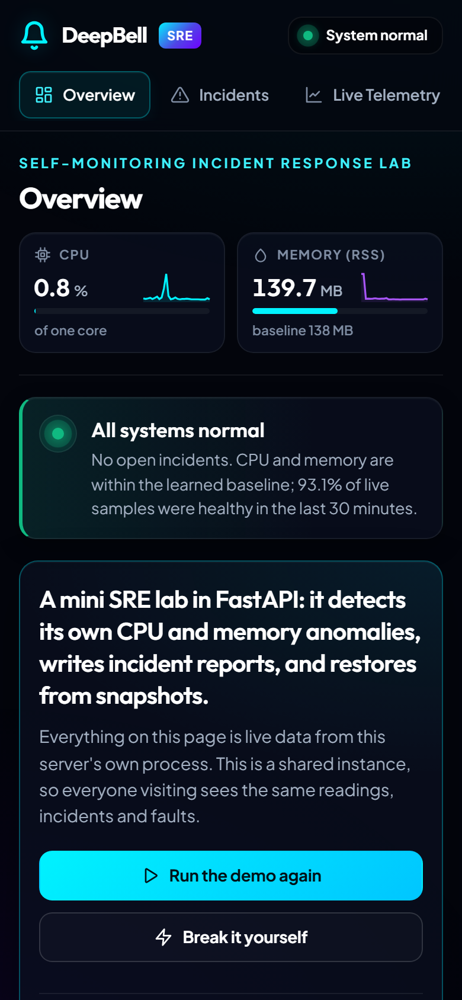
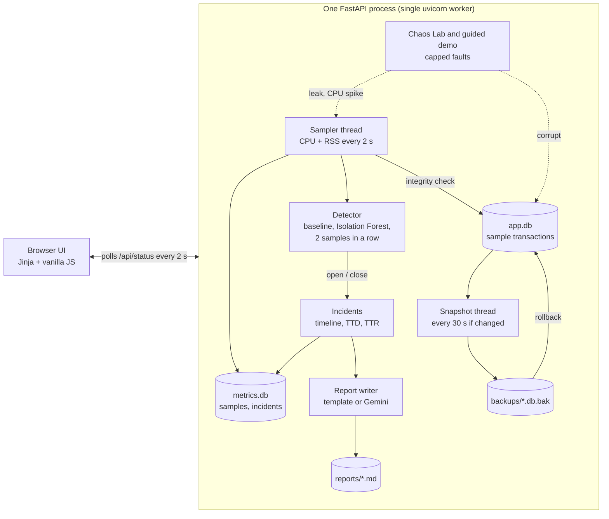

# DeepBell

A mini SRE lab in FastAPI: it detects its own CPU and memory anomalies, writes incident reports, and restores from snapshots.

Monitoring usually stops at an alert. DeepBell practises the steps after it: **detect → report → recover**. A background thread samples the service's own CPU and memory every 2 s, a baseline check plus an Isolation Forest flags anomalies and opens de-duplicated incidents, each incident gets a Markdown report (Google Gemini through LangChain when a key is set, a built-in template otherwise), and rolling SQLite snapshots give one-click rollback. A capped Chaos Lab lets you break it on purpose.

[](https://github.com/vishnuatgit/DeepBell/actions/workflows/ci.yml)

[](LICENSE)

## Live demo

**TODO: Render URL** (deployed from [`render.yaml`](render.yaml), see [Deploy on Render](#deploy-on-render)).

Open it and press **Run the guided demo**. The demo is one shared instance on Render's free plan: everyone sees the same telemetry and incidents, and the first visit after 15 quiet minutes takes about a minute while the service wakes up.



## Features

- **Live operations console.** The overview opens on a status banner (healthy, anomalous sample, incident open, connection lost), key numbers from real data (uptime, open incidents, median time to detect and to recover, with a bar per incident that links to it), live CPU and memory charts on a real time axis with the learned baseline, the alert line, flagged samples, shaded incident spans and visible gaps where no sample was taken, a 30-minute status strip, the latest report beside the recent incidents, and the server's event log. The header, the chart headings and the charts always show the same sample.
- **How it works, live.** A four-step pipeline (Sample, Detect, Report, Recover) lights up from the server's own state while an incident moves through it: "CPU spike injected 2 s ago", "1 of 2 anomalous samples in a row", "Report linked to incident #5", "Release the 60 MB of leaked memory to recover". It works for the guided demo and for any fault injected by hand, including one injected right after another incident resolved.
- **Guided demo.** One button runs a narrated scenario on the server: leak 60 MB, watch the watchdog open an incident and write its report, release the memory, watch the incident resolve, then corrupt the database and roll it back to a snapshot. A progress panel shows each step as it happens. It runs one scenario at a time, waits out shared cooldowns, and says why when another visitor's fault is in the way.
- **Self-monitoring watchdog.** A background thread samples the process's own CPU and resident memory every 2 s with `psutil` and scores each sample against a learned baseline (see [Detection logic](#detection-logic)).
- **Incidents and timelines.** Every incident records when it started (the injected fault, or its first anomalous sample), when it was detected and when it resolved, plus the reports and recovery actions in between. The Incidents view lists them with filters and shows each one's time to detect and time to recover, a lifecycle bar drawn to scale and its timeline. Times are computed from the server's own timestamps and labelled as demo measurements.
- **Incident reports.** Each incident gets a Markdown report: a deterministic built-in template by default, or Google Gemini when `GOOGLE_API_KEY` is set (with the template as fallback). The template describes only the incident's own fault: a database report never borrows a memory leak's samples. Every report is labelled with what wrote it (Gemini, template, template fallback, or the example written at startup) and downloads as `.md` with the incident's timeline and measured times appended.
- **Status strip.** Uptime-style bars for the last 30 minutes, built from the metrics history: healthy, flagged samples without an incident, incident open, synthetic warm-up, no data. A bar with an incident links to it.
- **Live Telemetry.** CPU and memory over 2 or 10 minutes, the detector's baseline and streaks, and a CPU-against-memory scatter plot that shows which samples crossed an alert line and became candidates for the Isolation Forest.
- **Time Machine.** The SQLite database is copied every 30 s when its contents changed (newest 10 kept, each integrity-checked). The Time Machine lists each snapshot with its size, whether it passes `PRAGMA quick_check` and how many transactions it holds, says whether the newest one holds the current data, and restores any of them in one click after a confirmation. A corrupt database is restored automatically at startup.
- **Chaos Lab.** Inject a CPU spike, a memory leak, database corruption or (locally) a hard crash, each with its caps and what to watch for shown on the card, and watch the pipeline, the charts and the event log react. On a phone the page scrolls to the live results after an injection.
- **Dashboard.** One Jinja template, one stylesheet and vanilla JavaScript with no build step; Chart.js and marked come from a CDN at pinned versions with subresource integrity. Dark theme by default with a light theme, toasts and confirmations for every fault, a "Connection lost" state that pauses every action while the server restarts, and a layout that works down to 360 px. Keyboard focus survives the live updates, screen readers hear state changes (not every new number), and reduced-motion settings are respected.



<p>
  
  
</p>

## How it works



1. **Sample.** Every 2 s the watchdog reads the process's CPU % and resident memory (RSS) and stores the sample in `metrics.db`. Inside a container with a CPU quota (0.1 CPU on Render's free plan), CPU is scaled to that quota.
2. **Detect.** The detector scores the sample. Two anomalous samples in a row open an incident; three normal ones close it. Every 2 s it also queries `app.db`, so a corrupted file opens a database incident.
3. **Report.** Opening an incident starts a report in a background thread. The report and every later action (memory released, snapshot restored) are added to the incident's timeline.
4. **Recover.** Releasing the leaked memory lets the samples return to the baseline, which closes the incident. Restoring a snapshot makes the database readable again, which closes the database incident.

Incident history is kept in `metrics.db`, not `app.db`, so corrupting or rolling back the application database never rewrites it.

Every user flow (landing, guided demo, each fault, incidents and reports, the Time Machine, reconnecting) and every system flow (startup, sampling and detection, the incident lifecycle, reports, snapshots, rollback, the live pipeline) is documented step by step, with diagrams, files, functions and error paths, in [docs/process-flows.md](docs/process-flows.md).

## Detection logic

The detector is deliberately conservative: a single noisy sample should never page anyone.

- **Baseline.** The newest 150 normal samples. CPU uses their 95th percentile and memory their median. The baseline is refitted every 5 minutes, not on every sample. A fresh instance seeds 60 synthetic warm-up samples so it can score at once; they are stored as `Warm-up (synthetic)`, drawn grey, and replaced by live samples after 30 live ones.
- **Candidate.** A sample is a candidate when CPU is at least 15 percentage points above the baseline or memory at least 30 MB above it.
- **Confirmation.** An Isolation Forest (100 trees, contamination 0.02) is fitted on the baseline window plus the candidate and must label the candidate an outlier. It runs only for new candidates, not on every sample. On its own the forest flagged ordinary jitter, which is why it only confirms candidates that already cleared the minimum deviation.
- **Consecutive samples.** Two anomalous samples in a row open an incident and three normal samples close it. While an incident is open its samples stay out of the baseline, so a leak that is still held never becomes the new normal. One incident (and one report) per fault kind at a time.
- **What it costs.** Detection needs at least two samples, so time to detect is at least one sample interval after the first anomalous sample. In six local runs of the guided demo the leak was detected 2 to 4 s after it was injected and resolved 10 to 13 s after detection (release, then three normal samples). These are demo measurements on a laptop, not production numbers.
- **What it misses.** Leaks smaller than 30 MB, CPU bursts shorter than two samples, and anything that is not CPU or memory. Database corruption is caught by a query, not by the model.

## Safety in public demo mode

Set `PUBLIC_DEMO=1` (the Render Blueprint does) when the app is reachable by anyone:

- `POST /api/settings/apikey` and the crash fault return 403, the Settings view is hidden, and no `.env` file is read. The app never writes `.env` in any mode.
- The guided demo runs in a server thread, one run at a time, with a 20 s cooldown after each run. A second visitor watches the run in progress instead of starting another, and a closed browser tab cannot leave a fault behind. If another visitor's leak or corruption is still in place after 15 s, the demo clears it (anyone can, from the Chaos Lab or the Time Machine) and says so.
- Leaked memory is released automatically after 5 minutes.

The caps and cooldowns apply in every mode:

| Fault | Limit |
|---|---|
| CPU spike | 1 to 5 seconds |
| Memory leak | 1 to 60 MB per request, 120 MB held at most, freed after 5 minutes |
| Every fault, and manual reports | Shared cooldown (20 s per fault, 30 s for reports); a request during it gets a 429 with `Retry-After` and a readable message |

## Tech stack

Python 3.11 and 3.12, FastAPI, Uvicorn, SQLite, psutil, scikit-learn and NumPy (Isolation Forest), LangChain with `langchain-google-genai` (only used when a key is set), Jinja2, Chart.js, marked, pytest, ruff, Docker, GitHub Actions and Render.

## Run locally

Requires Python 3.11 or 3.12.

```bash
git clone https://github.com/vishnuatgit/DeepBell.git
cd DeepBell
python -m venv .venv
source .venv/bin/activate          # Windows: .venv\Scripts\activate
pip install -r target_app/requirements.txt
cp .env.example .env               # optional; add GOOGLE_API_KEY for AI reports
python run_all.py
```

Open http://127.0.0.1:8000 and press **Run the guided demo**, or open the Chaos Lab. The API is documented at http://127.0.0.1:8000/docs, grouped by tag. `run_all.py` restarts the server after a crash; to run without it:

```bash
uvicorn main:app --app-dir target_app --port 8000
```

## Run with Docker

```bash
docker build -t deepbell .
docker run --rm -p 8000:8000 -e PUBLIC_DEMO=1 deepbell
```

The image is based on `python:3.11-slim`, runs as an unprivileged user and starts a single uvicorn worker (the app keeps its state and background threads in one process). It listens on `$PORT` (default 8000) and keeps its data in `/app/var`. Drop `-e PUBLIC_DEMO=1` to enable the crash fault and the Settings view; add `-e GOOGLE_API_KEY=...` for AI reports. `.dockerignore` keeps `.env`, local data and development files out of the image.

## Tests

```bash
pip install -r target_app/requirements.txt -r requirements-dev.txt
ruff check . && ruff format --check .
pytest --cov=target_app
```

89 tests. They use temporary directories, disable the background threads (or drive them with a fake clock) and replace the Gemini call with stubs, so they never touch the network. They cover the detector (jitter, spikes, held leaks, baseline refresh, warm-up), incident timelines and measured times, the live pipeline through a whole incident (and a new fault right after one resolves), the incident statistics, report sources, wording per fault kind, linking and download, the guided demo end to end (with a fast fake watchdog), the status strip, snapshots (readability, contents, freshness) and rollback, corruption detection, public demo mode, fault caps, cooldowns and auto-release, the OpenAPI tags and the main API endpoints. CI runs them on Python 3.11 and 3.12, lints with ruff, and builds and smoke-tests the Docker image.

## Deploy on Render

[`render.yaml`](render.yaml) is a Render Blueprint for a free Docker web service in the Singapore region, with `PUBLIC_DEMO=1` and a health check on `/healthz`.

1. Push the repository to GitHub.
2. In the Render dashboard choose **New > Blueprint** and select the repository.
3. When asked for `GOOGLE_API_KEY`, paste a Gemini key for AI-written reports, or leave it empty for template reports.
4. Deploy, then put the service URL in the [Live demo](#live-demo) section.

`autoDeployTrigger: checksPass` redeploys after each commit whose CI checks pass. The free plan has 0.1 CPU and 512 MB of RAM and an ephemeral disk (Render docs, checked 2026-10-31), so data resets on every restart; the app seeds itself on startup (60 synthetic warm-up samples, five sample transactions and one example report labelled as an example). In a local measurement (Windows, Python 3.11, 60 s windows) DeepBell idled at about 137 MB of resident memory and 0.3 % of one core with no visitors, or 0.6 % with one dashboard open; the guided demo and the Chaos Lab add at most 120 MB.

### Configuration

All variables are optional. See `.env.example`.

| Variable | Default | Purpose |
|---|---|---|
| `GOOGLE_API_KEY` | empty | Enables AI-written reports via Gemini. On local runs it can also be set in the Settings view (in memory until restart). |
| `GEMINI_MODEL` | `gemini-2.5-flash` | Gemini model for AI reports. |
| `PUBLIC_DEMO` | empty (off) | Set to `1` for a public deployment (see [Safety in public demo mode](#safety-in-public-demo-mode)). |
| `DEEPBELL_DATA_DIR` | `data/` | Folder for `app.db` and `metrics.db`. |
| `DEEPBELL_BACKUP_DIR` | `backups/` | Folder for snapshots. |
| `DEEPBELL_REPORTS_DIR` | `reports/` | Folder for incident reports. |
| `DEEPBELL_ENV_FILE` | `.env` | Settings file read at startup on local runs (never in public demo mode). |
| `DEEPBELL_SEED` | `1` | Set to `0` to skip the startup seed data. |
| `DEEPBELL_CPU_CORES` | detected | CPU cores available to the app, used to scale CPU %. Read from the container's cgroup quota when unset. |
| `DEEPBELL_DISABLE_WORKERS` | empty | Set to `1` to skip the telemetry and snapshot threads. |
| `HOST`, `PORT` | `127.0.0.1`, `8000` | Address and port used by `run_all.py`. The Docker image reads `PORT`. |

Default paths are relative to the project root. The Docker image sets the three data folders to `/app/var/...`.

## Project structure

```
DeepBell/
├── target_app/
│   ├── main.py              # FastAPI app: watchdog, incidents, reports, snapshots, guided demo, API
│   ├── requirements.txt     # Pinned runtime dependencies
│   ├── templates/index.html # The dashboard markup (one page, seven views)
│   └── static/              # app.js (behaviour), styles.css (dark and light themes), favicon.svg
├── tests/                   # pytest: test_app.py, test_watchdog.py, test_features.py, test_console.py
├── docs/
│   ├── process-flows.md     # Every user and system flow, with diagrams
│   ├── screenshots/         # README and portfolio images
│   └── major_project_proposal.md
├── run_all.py               # Supervisor: restarts the server after a crash
├── Dockerfile               # Production image (single uvicorn worker, non-root)
├── render.yaml              # Render Blueprint for the public demo
├── requirements-dev.txt     # Test and lint tools
├── pyproject.toml           # ruff and pytest settings
└── .github/workflows/ci.yml # Lint, tests, Docker build
```

`data/`, `backups/` and `reports/` are created at runtime and are git-ignored.

<details>
<summary><strong>API reference</strong></summary>

| Method | Path | Description |
|---|---|---|
| GET | `/` | Dashboard |
| GET | `/healthz` | Liveness check |
| GET | `/api/status` | Health, open incidents, last sample and its time, baseline, detector streaks, database state, fault cooldowns, guided-demo progress, the live pipeline (`pipeline`), the newest snapshot and whether it holds the current data, and uptime. `?events_after=N` also returns server events newer than N. |
| GET | `/api/status/history?minutes=&bars=` | Status-strip bars (default 30 minutes in 60 bars) and the share of healthy live samples |
| GET | `/api/metrics?limit=` | Latest telemetry samples, newest first (default 15, at most 400) |
| GET | `/api/incidents?limit=` | Incident history, newest first, with timelines and times to detect and recover |
| GET | `/api/incidents/stats` | Incident counts and median times to detect and recover over the newest 20 |
| GET | `/api/incidents/{id}` | One incident |
| GET | `/api/reports` | Kept reports, newest first, with title, incident and source (`gemini`, `template`, `template-fallback`, `example`) |
| GET | `/api/reports/latest` | Newest report (404 if none) |
| GET | `/api/reports/{name}` | One report as JSON |
| GET | `/api/reports/{name}/download` | One report as a Markdown file, with its incident timeline appended |
| GET | `/api/backups` | Snapshots, newest first, with their creation time, whether each is readable and how many transactions it holds |
| POST | `/api/rollback` | Form field `filename`: restore that snapshot |
| POST | `/api/rca/generate` | Write a report now (AI or template) |
| GET | `/api/demo` | Current or last guided-demo run and its cooldown |
| POST | `/api/demo/start` | Start the guided demo (409 while one runs, 429 during its cooldown) |
| POST | `/api/settings/apikey` | Form field `api_key`: set the Gemini key in memory (403 in public demo mode) |
| POST | `/transaction?amount=` | Insert a sample transaction (0 < amount ≤ 1,000,000; the newest 200 are kept) |
| GET | `/transactions` | Last 10 transactions (503 while the database is unreadable) |
| POST | `/fault/cpu_spike?duration_sec=` | Busy loop in a background thread (1 to 5 s) |
| POST | `/fault/memory_leak?size_mb=` | Hold 1 to 60 MB until released (120 MB at most) |
| POST | `/fault/memory_release` | Free all leaked memory |
| POST | `/fault/corrupt_db` | Overwrite the SQLite header of `app.db` |
| POST | `/fault/fatal_crash` | `os._exit(1)` after one second (403 in public demo mode) |

All timestamps in API responses are ISO-8601 in UTC; the UI shows them in the viewer's time zone. The interactive OpenAPI docs are at `/docs`.

</details>

## Limitations

- It monitors only itself, on two signals (CPU and resident memory). It is a lab for the detect, report, recover loop, not a general monitoring tool.
- The minimum deviations are fixed (15 CPU points, 30 MB), so smaller spikes and slow leaks are deliberately ignored.
- Snapshots are not point-in-time recovery: you can restore one of the last 10 distinct snapshots, taken at most every 30 s, and a rollback loses whatever changed since.
- At runtime the rollback is manual (or part of the guided demo); it is automatic only in the startup check.
- There is no authentication. Public demo mode disables the dangerous endpoints and caps the rest, but any visitor can inject the capped faults and roll back the shared database. Cooldowns are global and kept in memory.
- Open incidents, cooldowns, the guided demo and leaked memory live in one process, so the app must run as a single worker. If the server restarts while an incident is open, that incident is marked interrupted.
- Times to detect and recover are measured on injected faults in this lab and say nothing about a production system.

## License

[MIT](LICENSE) © 2026 Chandana Vishnu Jayanth · [Portfolio](https://vishnuatgit.github.io)
