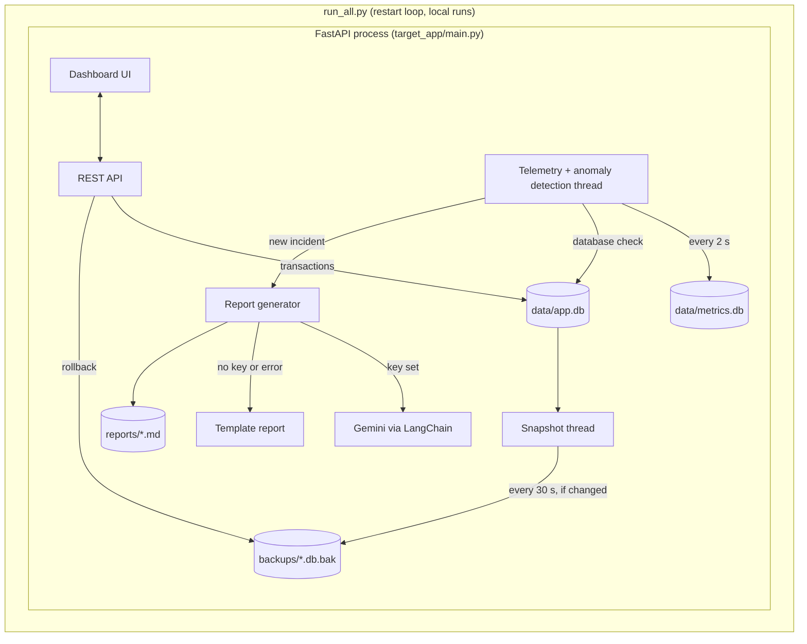

# DeepBell

A self-contained SRE demo: a FastAPI service that watches its own CPU and memory, flags anomalies with an Isolation Forest, keeps rolling SQLite snapshots you can roll back to, and writes an incident report for each anomaly.

[](https://github.com/vishnuatgit/DeepBell/actions/workflows/ci.yml)

[](LICENSE)

## Live demo

**TODO: Render URL** (deployed from [`render.yaml`](render.yaml), see [Deploy on Render](#deploy-on-render)).

The demo runs on Render's free plan in public demo mode:

- It is one shared instance. Everyone visiting sees the same telemetry and the same faults.
- Faults are capped and have a 20-second cooldown; the crash fault and the API-key setting are disabled.
- The service sleeps after 15 minutes without traffic, so the first visit after a quiet spell takes about a minute while it wakes up. Its disk is ephemeral, so data resets on every restart; the app seeds itself on startup (see [Startup seed data](#startup-seed-data)).

## What it does and why

Monitoring tools usually stop at an alert. DeepBell is a small, single-process lab for the steps after the alert: detect that something is off, keep restore points for the data, and write up what happened. It ships with a Chaos Lab so you can cause the failures yourself and watch the pipeline react.

Everything runs in one FastAPI process. The "target" being monitored is that same process and its SQLite database of sample transactions.

## Features

- **Telemetry collector**: a background thread samples the process CPU % and resident memory with `psutil` every 2 seconds and stores them in `data/metrics.db` with UTC timestamps. Inside a container with a CPU quota (0.1 CPU on Render's free plan), CPU is shown as a share of that quota, so a busy loop reads close to 100 % instead of 10 %.
- **Anomaly detection**:
  - The watchdog keeps a baseline window of the last 150 normal samples (95th-percentile CPU, median memory) and refreshes it every 5 minutes, not on every sample.
  - A sample becomes a candidate when CPU is at least 15 points above the baseline or memory at least 30 MB above it. An Isolation Forest, fitted on the baseline window plus the candidate, then confirms that the candidate is an outlier.
  - Two anomalous samples in a row open an incident (CPU spike or memory leak), and three normal ones close it. While an incident is open, its samples stay out of the baseline, so a leak that is still held keeps the system degraded until the memory is released.
  - Open incidents are de-duplicated: one incident and one report per fault.
- **Incident reports**: each new incident (or the "Generate report now" button) produces a Markdown report in `reports/`. The newest 20 are kept.
  - With `GOOGLE_API_KEY` set, the report is written by Google Gemini through LangChain. The client is only imported when a key is configured.
  - Without a key, or if the AI call fails, DeepBell writes a built-in template report from the same telemetry: summary, statistics, the recent telemetry table, a likely cause and recommended actions.
- **Database snapshots**: every 30 seconds a background thread copies `data/app.db` to `backups/` if its contents changed since the newest snapshot and the copy passes an integrity check. Each snapshot is named after its own creation time (UTC), and the 10 newest are kept. The Time Machine tab restores any of them with one click.
- **Database health**: the watchdog queries the database every 2 seconds. A corrupted file opens a "Database Error" incident, `/transactions` returns a 503 that explains how to recover, and health stays degraded until a rollback. On startup, a corrupted database is restored from the newest readable snapshot.
- **Supervisor**: `run_all.py` runs uvicorn in a loop and restarts it 2 seconds after any non-zero exit. The restarted app then runs the startup integrity check.
- **Chaos Lab**: inject a CPU spike (up to 5 s), a memory leak (60 MB per click, up to 120 MB held, with a "Release memory" action), database corruption (overwrites the SQLite header) or, outside public demo mode, a hard process exit. Results show on the same tab: a live chart with anomalous samples in red, the server's event log and the latest report.
- **Dashboard**: the "How this demo works" card, transactions you can add (and lose to corruption), toasts and confirmations for every fault, and a layout that works down to 390 px wide. All times are stored in UTC and shown in the viewer's time zone.

## Architecture



## Tech stack

Python, FastAPI, Uvicorn, Jinja2, SQLite, psutil, NumPy, scikit-learn, LangChain with `langchain-google-genai` (only used when a key is set), Chart.js and marked (loaded from a CDN at pinned versions with subresource integrity), pytest, ruff, Docker, GitHub Actions.

## Quick start

Requires Python 3.11 or 3.12.

```bash
git clone https://github.com/vishnuatgit/DeepBell.git
cd DeepBell
python -m venv .venv
source .venv/bin/activate          # Windows: .venv\Scripts\activate
pip install -r target_app/requirements.txt
cp .env.example .env               # optional; add GOOGLE_API_KEY for AI reports
python run_all.py
```

Open http://127.0.0.1:8000. The watchdog starts scoring at once from the seeded warm-up data. Open the Chaos Lab, inject a CPU spike or a memory leak, and watch the incident and its report appear.

To run the app without the supervisor:

```bash
uvicorn main:app --app-dir target_app --port 8000
```

## Run with Docker

```bash
docker build -t deepbell .
docker run --rm -p 8000:8000 -e PUBLIC_DEMO=1 deepbell
```

The image is based on `python:3.11-slim`, runs as an unprivileged user and starts a single uvicorn worker (the app keeps its state and background threads in one process). It listens on `$PORT` (default 8000) and keeps its data in `/app/var`. Drop `-e PUBLIC_DEMO=1` to enable the crash fault and the Settings key form; add `-e GOOGLE_API_KEY=...` for AI reports. `.dockerignore` keeps `.env`, local data and development files out of the image. CI builds the image and smoke-tests it on every push.

## Deploy on Render

[`render.yaml`](render.yaml) is a Render Blueprint for a free Docker web service in the Singapore region, with `PUBLIC_DEMO=1` and a health check on `/healthz`.

1. Push the repository to GitHub.
2. In the Render dashboard choose **New > Blueprint** and select the repository.
3. When asked for `GOOGLE_API_KEY`, either paste a Gemini key for AI-written reports or leave it empty for template reports.
4. Deploy, then put the service URL in the [Live demo](#live-demo) section.

`autoDeployTrigger: checksPass` redeploys after each commit whose CI checks pass. The free plan has 0.1 CPU and 512 MB of RAM (Render docs, checked 2026-10-31). In local measurements (Windows, Python 3.11) DeepBell idled at about 135 MB of resident memory and well under 1 % of one core; the Chaos Lab can add at most 120 MB.

## Public demo mode

Set `PUBLIC_DEMO=1` (the Blueprint does) when the app is reachable by anyone:

- `POST /api/settings/apikey` returns 403 and the Settings tab shows the key status instead of a form. The key can only come from the host's environment.
- The fatal-crash fault returns 403.
- No `.env` file is read. The app never writes `.env` in any mode; a key entered in the Settings tab on a local run is kept in memory only.

The caps and cooldowns below apply in every mode:

| Fault | Limit |
|---|---|
| CPU spike | 1 to 5 seconds |
| Memory leak | 1 to 60 MB per request, 120 MB held at most; `POST /fault/memory_release` frees it |
| Every fault, and manual reports | Global cooldown (20 s per fault, 30 s for reports); a request during it gets a 429 with `Retry-After` and a readable message |

## Startup seed data

So that a fresh or just-woken instance has something to show, startup adds (unless `DEEPBELL_SEED=0`):

- 60 synthetic warm-up telemetry samples around the first live reading, stored with the status `Warm-up (synthetic)` and drawn as a grey dashed line. The watchdog uses them as its first baseline and replaces them with live samples after about a minute. They are skipped if live samples from the last 5 minutes exist.
- Five sample transactions, if the table is empty.
- One example incident report built from synthetic telemetry and labelled as an example, if there are no reports.

## Configuration

All variables are optional. See `.env.example`.

| Variable | Default | Purpose |
|---|---|---|
| `GOOGLE_API_KEY` | empty | Enables AI-written reports via Gemini. On local runs it can also be set from the Settings tab (in memory until restart). |
| `GEMINI_MODEL` | `gemini-2.5-flash` | Gemini model for AI reports. |
| `PUBLIC_DEMO` | empty (off) | Set to `1` for a public deployment (see [Public demo mode](#public-demo-mode)). |
| `DEEPBELL_DATA_DIR` | `data/` | Folder for `app.db` and `metrics.db`. |
| `DEEPBELL_BACKUP_DIR` | `backups/` | Folder for snapshots. |
| `DEEPBELL_REPORTS_DIR` | `reports/` | Folder for incident reports. |
| `DEEPBELL_ENV_FILE` | `.env` | Settings file read at startup on local runs (never in public demo mode). |
| `DEEPBELL_SEED` | `1` | Set to `0` to skip the startup seed data. |
| `DEEPBELL_CPU_CORES` | detected | CPU cores available to the app, used to scale CPU %. Read from the container's cgroup quota when unset. |
| `DEEPBELL_DISABLE_WORKERS` | empty | Set to `1` to skip the telemetry and snapshot threads. |
| `HOST`, `PORT` | `127.0.0.1`, `8000` | Address and port used by `run_all.py`. The Docker image reads `PORT`. |

Default paths are relative to the project root. The Docker image sets the three data folders to `/app/var/...`.

## Running tests

```bash
pip install -r target_app/requirements.txt -r requirements-dev.txt
ruff check . && ruff format --check .
pytest --cov=target_app
```

The tests use temporary directories, disable the background threads and replace the Gemini call with stubs, so they never touch the network. They cover the anomaly detector (jitter, spikes, held leaks, baseline refresh and warm-up), incident de-duplication, snapshots (own timestamps, skipping unchanged or corrupt databases, retention), corruption detection and rollback, public demo mode, fault caps and cooldowns, the template and AI report paths, seeding and the main API endpoints. CI runs them on Python 3.11 and 3.12, lints with ruff, and builds and smoke-tests the Docker image.

## Project structure

```
DeepBell/
├── target_app/
│   ├── main.py              # FastAPI app, watchdog, snapshots, reports, Chaos Lab
│   ├── requirements.txt     # Pinned runtime dependencies
│   ├── templates/index.html # Dashboard
│   └── static/              # styles.css, favicon.svg
├── tests/                   # pytest suite (test_app.py, test_watchdog.py)
├── docs/major_project_proposal.md
├── run_all.py               # Supervisor: restarts the server after a crash
├── Dockerfile               # Production image (single uvicorn worker, non-root)
├── render.yaml              # Render Blueprint for the public demo
├── requirements-dev.txt     # Test and lint tools
├── pyproject.toml           # ruff and pytest settings
└── .github/workflows/ci.yml # Lint, tests, Docker build
```

`data/`, `backups/` and `reports/` are created at runtime and are git-ignored.

## API reference

| Method | Path | Description |
|---|---|---|
| GET | `/` | Dashboard |
| GET | `/healthz` | Liveness check |
| GET | `/api/status` | Health, open incidents, last CPU/RAM sample, baseline, database state, fault cooldowns and limits. `?events_after=N` also returns server events newer than N. |
| GET | `/api/metrics?limit=` | Latest telemetry samples, newest first (default 15, at most 300) |
| GET | `/api/reports/latest` | Newest incident report (404 if none) |
| GET | `/api/backups` | Snapshots, newest first, with their creation time |
| POST | `/api/rollback` | Form field `filename`: restore that snapshot |
| POST | `/api/rca/generate` | Generate a report now (AI or template) |
| POST | `/api/settings/apikey` | Form field `api_key`: set the Gemini key in memory (403 in public demo mode) |
| POST | `/transaction?amount=` | Insert a sample transaction (0 < amount ≤ 1,000,000; the newest 200 are kept) |
| GET | `/transactions` | Last 10 transactions (503 while the database is unreadable) |
| POST | `/fault/cpu_spike?duration_sec=` | Busy loop in a background thread (1 to 5 s) |
| POST | `/fault/memory_leak?size_mb=` | Hold 1 to 60 MB until released (120 MB at most) |
| POST | `/fault/memory_release` | Free all leaked memory |
| POST | `/fault/corrupt_db` | Overwrite the SQLite header of `app.db` |
| POST | `/fault/fatal_crash` | `os._exit(1)` after one second (403 in public demo mode) |

All timestamps in API responses are ISO-8601 in UTC.

## Limitations and roadmap

- Snapshot-based recovery, not true point-in-time recovery: you can restore one of the last 10 distinct snapshots, taken at most every 30 seconds, not an arbitrary moment.
- A corrupted database is detected while the app runs, but restored automatically only at startup; at runtime the rollback is manual, so you can watch it happen.
- The watchdog monitors its own process only, on two signals (CPU and resident memory). The minimum deviations (15 CPU points, 30 MB) mean smaller spikes and leaks are deliberately ignored.
- There is no authentication. Public demo mode disables the dangerous endpoints and caps the rest, but any visitor can still inject the capped faults and roll back the shared database. Cooldowns are global and kept in memory.
- Incidents, events, cooldowns and leaked memory live in one process, so the app must run as a single worker.
- Roadmap: per-visitor rate limits, an opt-in automatic restore after runtime corruption, and a metrics endpoint for Prometheus.

## License

[MIT](LICENSE) © 2026 Chandana Vishnu Jayanth
