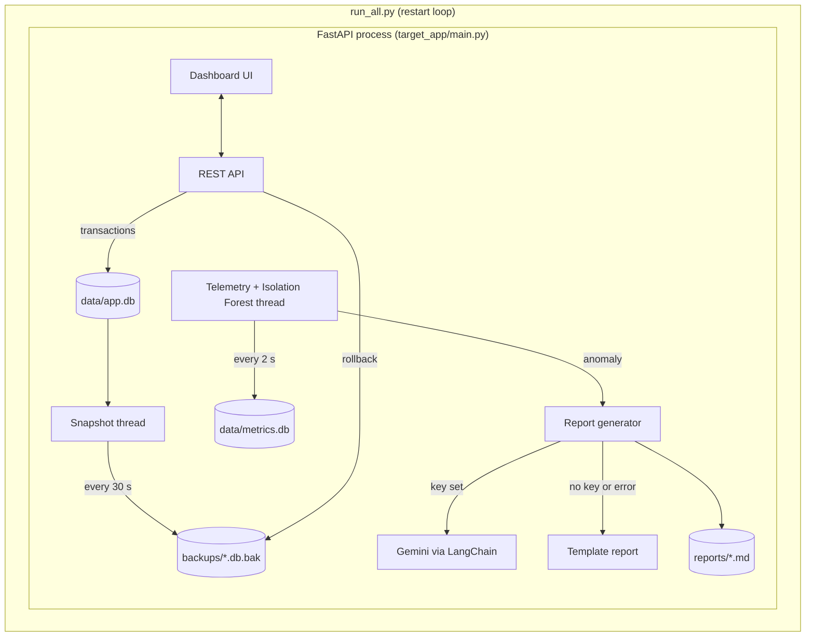

# DeepBell

A self-contained SRE demo: a FastAPI service that watches its own CPU and memory, flags anomalies with an Isolation Forest, keeps rolling SQLite snapshots you can roll back to, and writes an incident report for each anomaly.

[](https://github.com/vishnuatgit/DeepBell/actions/workflows/ci.yml)

[](LICENSE)

## What it does and why

Monitoring tools usually stop at an alert. DeepBell is a small, single-process lab for the steps after the alert: detect that something is off, keep restore points for the data, and write up what happened. It ships with a Chaos Lab so you can cause the failures yourself and watch the pipeline react.

Everything runs in one FastAPI process. The "target" being monitored is that same process and its SQLite database of sample transactions.

## Features

- **Telemetry collector**: a background thread samples the process CPU % and resident memory with `psutil` every 2 seconds and stores them in `data/metrics.db`.
- **Anomaly detection**: once 15 samples exist, each new sample is scored by a scikit-learn `IsolationForest` trained on the last 200 samples. Flagged samples are labelled CPU spike, memory leak or system degradation.
- **Incident reports**: an anomaly (or the "Trigger Documentation Generator" button) produces a Markdown report in `reports/`.
  - With `GOOGLE_API_KEY` set, the report is written by Google Gemini through LangChain.
  - Without a key, or if the AI call fails, DeepBell writes a built-in template report from the same telemetry: summary, statistics, the recent telemetry table, a likely cause and recommended actions. The dashboard says so when no key is set.
- **Database snapshots**: a background thread copies `data/app.db` to `backups/` every 30 seconds (skipping a database that fails to read) and keeps the 10 newest. The Time Machine tab restores any of them with one click.
- **Startup integrity check**: on start, the app runs `PRAGMA quick_check` on the database; if it fails, it restores the newest snapshot before creating tables.
- **Supervisor**: `run_all.py` runs uvicorn in a loop and restarts it 2 seconds after any non-zero exit. The restarted app then runs the startup integrity check.
- **Chaos Lab**: inject a CPU spike, a memory leak, database corruption (overwrites the SQLite header) or a hard process exit.

## Architecture



## Tech stack

Python, FastAPI, Uvicorn, Jinja2, SQLite, psutil, pandas, scikit-learn, LangChain with `langchain-google-genai` (only used when a key is set), Chart.js and marked (loaded from a CDN by the dashboard), pytest, ruff, GitHub Actions.

## Quick start

Requires Python 3.11 or 3.12.

```bash
git clone https://github.com/vishnuatgit/DeepBell.git
cd DeepBell
python -m venv .venv
source .venv/bin/activate          # Windows: .venv\Scripts\activate
pip install -r target_app/requirements.txt
cp .env.example .env               # optional; add GOOGLE_API_KEY for AI reports
python run_all.py
```

Open http://127.0.0.1:8000. The status shows "Training Model..." for the first ~30 seconds while telemetry accumulates. Then open the Chaos Lab and inject a CPU spike or memory leak. Once the watchdog flags it, reload the page to see the new report on the Overview tab (the "Trigger Documentation Generator" button refreshes it for you).

To run the app without the supervisor:

```bash
cd target_app
uvicorn main:app --port 8000
```

## Configuration

All variables are optional. See `.env.example`.

| Variable | Default | Purpose |
|---|---|---|
| `GOOGLE_API_KEY` | empty | Enables AI-written reports via Gemini. Can also be set from the Settings tab (saved to the `.env` file). |
| `GEMINI_MODEL` | `gemini-2.5-flash` | Gemini model for AI reports. |
| `DEEPBELL_DATA_DIR` | `data/` | Folder for `app.db` and `metrics.db`. |
| `DEEPBELL_BACKUP_DIR` | `backups/` | Folder for snapshots. |
| `DEEPBELL_REPORTS_DIR` | `reports/` | Folder for incident reports. |
| `DEEPBELL_ENV_FILE` | `.env` | File the Settings tab writes the API key to. |
| `DEEPBELL_DISABLE_WORKERS` | empty | Set to `1` to skip the telemetry and snapshot threads. |

Default paths are relative to the project root.

## Running tests

```bash
pip install -r target_app/requirements.txt -r requirements-dev.txt
ruff check . && ruff format --check .
pytest --cov=target_app
```

The tests use temporary directories, disable the background threads and replace the Gemini call with stubs, so they never touch the network. They cover the template report, the AI path and its fallback, snapshot rollback, rejected snapshot names, corruption healing, settings and the main API endpoints. CI runs them on Python 3.11 and 3.12.

## Project structure

```
DeepBell/
├── target_app/
│   ├── main.py              # FastAPI app, background threads, reports, Chaos Lab
│   ├── requirements.txt     # Pinned runtime dependencies
│   ├── templates/index.html # Dashboard
│   └── static/styles.css
├── tests/                   # pytest suite
├── docs/major_project_proposal.md
├── run_all.py               # Supervisor: restarts the server after a crash
├── requirements-dev.txt     # Test and lint tools
├── pyproject.toml           # ruff and pytest settings
└── .github/workflows/ci.yml
```

`data/`, `backups/` and `reports/` are created at runtime and are git-ignored.

## API reference

| Method | Path | Description |
|---|---|---|
| GET | `/` | Dashboard |
| GET | `/api/status` | Health label, last CPU/RAM sample, report-in-progress flag, whether a key is configured |
| GET | `/api/metrics` | Last 15 telemetry samples |
| GET | `/api/backups` | Snapshots, newest first |
| POST | `/api/rollback` | Form field `filename`: restore that snapshot |
| POST | `/api/rca/generate` | Generate a report now (AI or template) |
| POST | `/api/settings/apikey` | Form field `api_key`: set the Gemini key |
| POST | `/transaction?amount=` | Insert a sample transaction |
| GET | `/transactions` | Last 10 transactions |
| GET | `/fault/cpu_spike?duration_sec=` | Busy loop in a background thread |
| GET | `/fault/memory_leak?size_mb=` | Allocate memory that is never freed |
| GET | `/fault/corrupt_db` | Overwrite the SQLite header of `app.db` |
| GET | `/fault/fatal_crash` | `os._exit(1)` after one second |

## Deployment

There is no hosted instance. The app is one process with local SQLite files, so any host that runs Python with a writable disk will work. On hosts with an ephemeral filesystem (for example free tiers that sleep and redeploy), the databases, snapshots and reports reset on every redeploy.

## Limitations and roadmap

- Snapshot-based recovery, not true point-in-time recovery: you can restore one of the last 10 snapshots (taken every 30 seconds), not an arbitrary moment.
- Database corruption is healed automatically only at startup or by a manual rollback. While the app runs, a corrupted database stops being snapshotted but is not restored until the next restart.
- The watchdog monitors its own process only and retrains the Isolation Forest on every sample, which costs some CPU.
- The Isolation Forest uses a fixed contamination rate, so it can flag ordinary jitter, and each flagged sample can start a new report.
- No authentication: the Chaos Lab and settings endpoints are open to anyone who can reach the server. Run it locally or on a private network.
- Fault endpoints use GET for convenience; they should be POST.
- Roadmap: runtime integrity checks with automatic restore, incident de-duplication, a Docker image and a deploy blueprint.

## License

[MIT](LICENSE) © 2026 Chandana Vishnu Jayanth
