# DeepBell process flows

Every flow in DeepBell, written against the code in this repository. User flows describe what a visitor does in the dashboard; system flows describe what the server does on its own. Each section lists the steps, the files and functions involved, and what happens when something goes wrong.

The backend is the `target_app/deepbell` package, one module per responsibility (see the project structure in the README); `target_app/main.py` only creates the FastAPI app and includes the routers from `deepbell/routes/`. Backend functions are named here as `module.function`, relative to `deepbell` (so `chaos.rollback_to()` is in `target_app/deepbell/chaos.py`, `routes.chaos.inject_cpu_spike()` in `target_app/deepbell/routes/chaos.py` and `runtime.open_incidents` is shared state in `runtime.py`). The page is `target_app/templates/index.html`, and its behaviour is `target_app/static/app.js`. Times in the API are UTC (ISO-8601); the page shows them in the viewer's time zone.

**Contents**

- User flows: [U1 Landing on the console](#u1-landing-on-the-live-console) · [U2 Guided demo](#u2-guided-demo) · [U3 CPU spike](#u3-chaos-lab-cpu-spike) · [U4 Memory leak and release](#u4-chaos-lab-memory-leak-and-release) · [U5 Database corruption and rollback](#u5-chaos-lab-database-corruption-and-rollback) · [U6 Fatal crash and reconnect](#u6-fatal-crash-and-reconnect-local-runs-only) · [U7 Incidents and reports](#u7-incidents-timelines-and-reports) · [U8 Time Machine](#u8-time-machine-transactions-and-snapshots) · [U9 Live Telemetry](#u9-live-telemetry) · [U10 Settings](#u10-settings-gemini-key-local-runs-only) · [U11 Navigation, theme and accessibility](#u11-navigation-theme-and-accessibility) · [U12 Connection lost](#u12-connection-lost-and-server-restart)
- System flows: [S1 Startup](#s1-startup) · [S2 Sampling and detection](#s2-sampling-and-anomaly-detection) · [S3 Incident lifecycle](#s3-incident-lifecycle-and-timeline) · [S4 Report generation](#s4-incident-report-generation) · [S5 Snapshots](#s5-snapshot-worker) · [S6 Database health and rollback](#s6-database-health-check-and-rollback) · [S7 Guided demo scenario](#s7-guided-demo-scenario-server-side) · [S8 Live pipeline](#s8-live-pipeline-state) · [S9 Polling, events and history](#s9-status-polling-events-status-strip-and-kpis) · [S10 Supervisor](#s10-supervisor-restart-loop) · [S11 Public demo safety](#s11-public-demo-safety-caps-and-cooldowns)

---

## User flows

### U1. Landing on the live console

A visitor opens `/` and lands on the Overview, top to bottom: a status banner, the one-line description with the "How it works" pipeline and the guided demo, four key numbers, live CPU and memory charts, the 30-minute status strip, the latest report beside the recent incidents, and the watchdog with the shared `server_events` log.

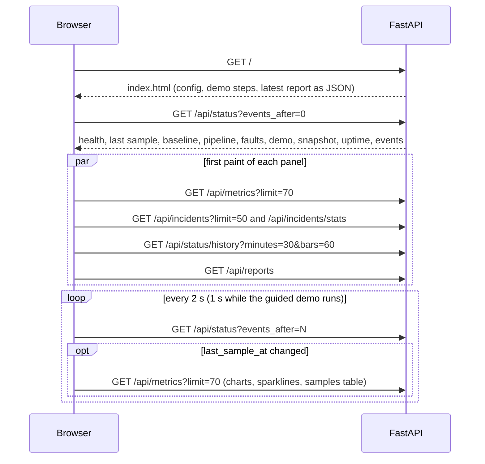

Steps

1. `routes.pages.read_dashboard()` renders the template with the latest report, the caps (`config`) and `config.DEMO_STEPS`, so the demo steps and the report are visible before any JavaScript runs.
2. `app.js` starts on `DOMContentLoaded`: it sets up Markdown rendering (`initMarkdown`), the charts (`initCharts`), the status strip and the theme, then calls `pollStatus()`, `loadIncidents()` and `loadReports()`.
3. `renderStatus()` fills the header cards and the chart headings from the same sample, the sidebar status, the banner (`renderBanner`), the watchdog card, the pipeline (`renderPipeline`), the Chaos Lab buttons, the demo panel and the uptime tile. When `last_sample_at` changes it calls `loadTelemetry()`, so every number and chart on the page shows the same newest sample.
4. `drawTelemetry()` draws the charts on a time axis that ends at the server's "now" (`updateLine`): the learned baseline and alert line, flagged samples in red, shaded spans while an incident was open (`incidentBands`) and blank spans where no sample was taken for more than three intervals (`seriesFrom`), all drawn by `overlayPlugin`. The header sparklines use the last 30 samples.
5. `loadHistory()` (every 15 s on the Overview) draws the status strip; `loadIncidents()` fills the key numbers (`renderKpis`: each small bar links to its incident and names it on hover) and the recent incidents whenever `incidents_rev` changes.
6. The banner's "Last snapshot" says "up to date" when the newest snapshot holds exactly the live data (`snapshots.latest_snapshot()["current"]`).

Empty, loading and edge states

- Skeleton bars and rows show until the first data arrives; nothing shifts when it does.
- No incidents yet: the recent-incidents list and the Incidents view show an empty state with "Run the guided demo" and "Open the Chaos Lab"; while a demo runs it offers "Watch the guided demo" instead.
- Fresh server: 60 synthetic warm-up samples (grey, dashed) let the watchdog score at once; right after a restart without them, the banner says "Learning the baseline" and the header shows dashes until `last_sample_at` is set.
- The example report seeded at startup is labelled "Example, synthetic data"; template reports are labelled "Built-in template".
- Chart.js or marked fail to load from the CDN: charts are replaced by a note (the samples table still works) and reports render as plain text.

### U2. Guided demo

One button runs the whole detect, report, recover loop on the server. The page shows each step as it happens, and the "How it works" pipeline lights up from the server's own state.

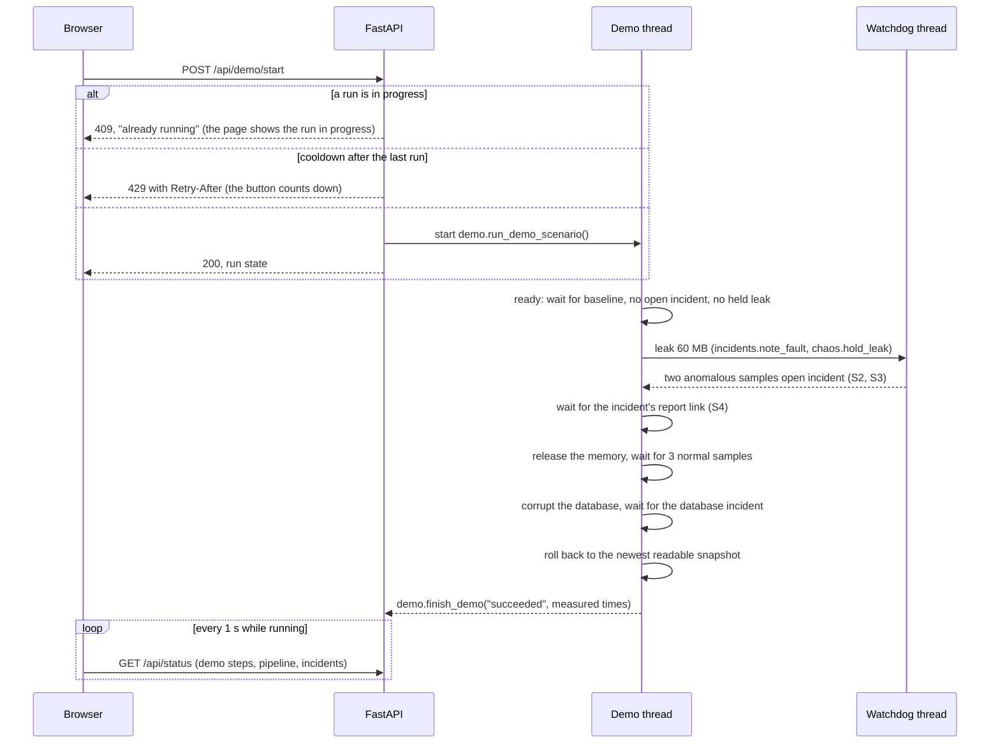

Steps

1. `startDemo()` puts the button in a loading state and calls `POST /api/demo/start` (`routes.demo.post_demo_start()`), which creates the run (`demo.new_demo_run`) and starts `demo.run_demo_scenario()` in a daemon thread.
2. `renderDemo()` reads `status.demo` on every poll: step states (pending, active with a spinner, done with a check, failed), the newest step's detail, a progress bar, the badge ("Step 5 of 8", "Succeeded", "Stopped") and the summary with links to the incident timelines (`#incidents/<id>`). The summary is re-rendered only when its text changes, so a focused link keeps its focus.
3. While the demo is about to act, the pipeline's Recover step says so ("The guided demo releases the 60 MB next", "rolls back to the newest snapshot next") instead of asking the visitor to act (`overview.demo_will`).
4. Elsewhere in the app a chip under the header ("Guided demo running: step 3 of 8, …") links back to the Overview.
5. Each step that finishes while the page is open is announced once through the page's live region (`announce`); steps that were already finished when the page loaded are not read out.

Error paths

- Another run is active: 409 with a readable message; the visitor watches the same run, labelled "started by another visitor".
- Just finished: 429 with `Retry-After`; the button reads "Run again in N s".
- The shared server is busy (learning, open incident, held leak): the "ready" step explains what it is waiting for; after 15 s the demo clears a leftover leak or corruption itself (`demo.demo_get_ready`); after 45 s it stops with the reason.
- A fault's shared cooldown is running: `demo.demo_claim()` waits and says so.
- Any step times out (30 s; 90 s for a Gemini report): `demo.DemoFailed`, the step turns red with the reason, the run ends "Stopped" and the 20 s cooldown starts. Held memory is always released in `finally`.
- A visitor releases the demo's memory first: the release step says "Another visitor released it first" and the run carries on.

### U3. Chaos Lab: CPU spike

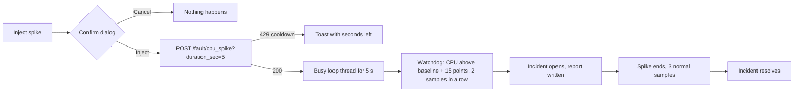

1. Each fault card states its caps and what to watch for. `injectFault('cpu_spike')` opens the confirmation dialog (`confirmAction`), then calls the endpoint with the button in a loading state.
2. `routes.chaos.inject_cpu_spike()` validates 1 to 5 s (400 otherwise), claims the shared cooldown (`chaos.claim_fault`, 429 with `Retry-After` when cooling down), records the fault as pending (`incidents.note_fault`) and runs `busy_loop` in a thread.
3. The Live results panel shows the compact pipeline and a caption that follows detection step by step, even right after another incident resolved: "Detect: CPU spike injected 2 s ago; waiting for 2 anomalous samples in a row", then "1 of 2 anomalous samples in a row (cpu spike)", then the incident, its report and "1 of 3 normal samples in a row" (S8). Beside it are the mini charts with red flagged points, the shared `server_events` log and the latest report.
4. On a phone (900 px or narrower) the page scrolls to Live results after a successful injection (`showResults`), so detection is visible without searching for it.
5. The button shows "Cooling down, N s" with a thin progress line until the 20 s cooldown ends.

### U4. Chaos Lab: memory leak and release

1. "Inject 60 MB leak" asks for confirmation, then calls `POST /fault/memory_leak?size_mb=60`. `routes.chaos.inject_memory_leak()` checks 1 to 60 MB (400), the 120 MB cap (409, "Release it first"), the cooldown (429), then `incidents.note_fault` and `chaos.hold_leak` (an anonymous `mmap` with every page written, so it counts towards RSS at once).
2. The leak meter fills (`role="meter"`), and the card shows "60 of 120 MB held, auto-release in 4 min 59 s". The header, the chart headings and the charts show the same sample, so the jump reads the same everywhere.
3. While memory is held the incident stays open and the pipeline's Recover step is amber and marked "act now": "Release the 60 MB of leaked memory to recover."
4. At the cap the button reads "Limit reached" with "release memory first", whatever the cooldown, because waiting would not help (`renderFaults`).
5. "Release memory" calls `POST /fault/memory_release` (`chaos.release_leak`), which frees every block and records the action on the open incident's timeline. Three normal samples later the incident resolves. If nothing was held, the toast says so.
5. A leak nobody releases is freed after 5 minutes by `chaos.release_stale_leak()` on the watchdog tick, so a closed tab cannot hold the shared demo in an incident.

### U5. Chaos Lab: database corruption and rollback

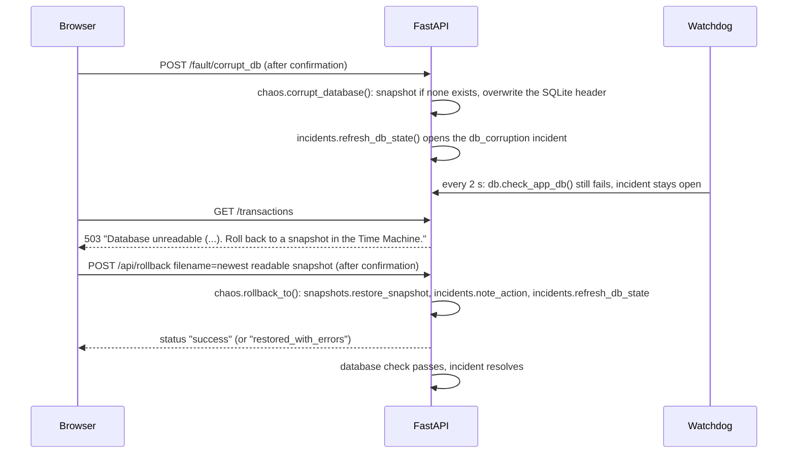

1. The red alert on the Chaos Lab and the Time Machine names the SQLite error; transactions show the same error without another request, and "Add" is disabled.
2. "Restore newest snapshot" picks the newest snapshot that passes `PRAGMA quick_check`; the confirmation says how many transactions it holds and that later changes are lost.
3. `chaos.rollback_to()` re-checks the database at once, so the database incident resolves immediately, the banner turns green and the pipeline's Recover step shows "resolved after N s".
4. The incident's template report describes the database fault only: "The database check failed (SQLite error: file is not a database). CPU and memory are not part of this fault." Samples flagged for another fault in the same window are named as such (S4).

### U6. Fatal crash and reconnect (local runs only)

1. On a local run, "Crash server" calls `POST /fault/fatal_crash`; `routes.chaos.inject_fatal_crash()` exits the process with `os._exit(1)` one second later. In public demo mode it returns 403 and the card is disabled with the reason.
2. Under `run_all.py` the supervisor restarts uvicorn after 2 s (S10), and startup (S1) checks the database and marks the incidents that were open as interrupted.
3. The page shows the reconnect banner (U12) and recovers by itself.

### U7. Incidents, timelines and reports

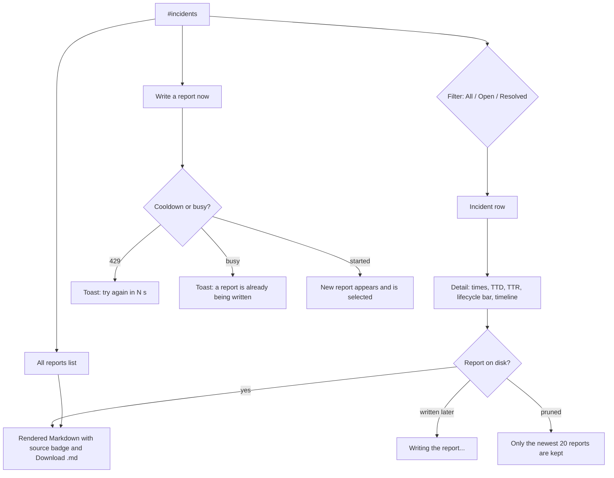

1. `loadIncidents()` reads `GET /api/incidents?limit=50` and `GET /api/incidents/stats`; `renderIncidentList()` shows each incident with its kind icon, times and status, and the counts on the filter buttons. Clicks are handled once on the list (event delegation), and the list is re-rendered only when its content changes, keeping keyboard focus on the same row.
2. A deep link `#incidents/<id>` (from the banner, the strip, the demo summary, the key-number bars or recent incidents) selects that incident; a missing id gets a toast. Choosing an incident announces "Showing incident #N" to screen readers.
3. `renderDetail()` shows started, detected and resolved times, time to detect and time to recover, a lifecycle bar drawn to scale in real seconds (`renderLifecycle`; a zero-length segment still shows as a 4 px tick, and an open incident's bar grows on every poll) and the timeline (fault, flagged, detected, report, action, resolved or interrupted).
4. `showReport()` loads `GET /api/reports/{name}`; `renderReport()` renders it with `marked` (raw HTML escaped, links limited to http(s) and mailto, images reduced to their alt text) and a badge for its source: Gemini via LangChain, built-in template, template fallback, or example.
5. "Download .md" calls `GET /api/reports/{name}/download` (`reports.report_for_download`), which appends the incident's timeline, its time to detect and its time to recover.
6. "Write a report now" is on the Incidents toolbar and on the Overview's report panel; both share the 30 s cooldown and the "Writing…" state.

Error paths: invalid report names return 400 and unknown ones 404 ("Only the newest 20 are kept"); a failed load shows the error in the report area.

### U8. Time Machine: transactions and snapshots

1. Add a transaction: `validateAmount()` checks the input before sending (empty, not a number, at most 0, above 1,000,000) and shows the message under the field with `aria-invalid`. The server repeats the check in `routes.transactions.create_transaction()` (400) and keeps the newest 200 rows. A new row flashes in the table.
2. Snapshots: `GET /api/backups` lists each snapshot with its time, size, whether it passes `quick_check` and how many transactions it holds (`snapshots.snapshot_info`). A small track shows when each was taken; unreadable ones are red and cannot be restored. The newest one is marked "same as live data" when it is current, and a three-step strip under the table explains how snapshots are taken and restored.
3. Restore: the confirmation names the snapshot time and its transaction count; `POST /api/rollback` validates the name (400 for anything that is not `app_YYYYMMDD_HHMMSS.db.bak`, 404 if missing) and restores it (S6). The table refreshes every 10 s without replacing a focused Restore button (only the "x min ago" text is updated).
4. While the database is unreadable the panel shows the error, "Add" is disabled and the newest snapshot's Restore button turns red.

### U9. Live Telemetry

1. Two charts (CPU, memory) on a time axis with the learned baseline, the alert line, flagged samples in red, shaded incident spans and blank spans where no sample was taken (a restart, or a sampler starved by the CPU spike). The 2 min / 10 min toggle sets the window and requests `GET /api/metrics?limit=70|310` (the endpoint returns at most 400). Hovering a point shows its time, value, the alert line and the watchdog's label.
2. The Detector card shows the baseline source, 95th-percentile CPU, median memory, the current streaks and how many times the Isolation Forest ran.
3. "What the runtime.detector sees" plots every sample as CPU against memory, with both alert lines and the candidate region shaded, so the two-gate rule is visible.
4. The samples table (newest first) shows each sample's memory distance from the baseline ("Memory vs baseline") and the watchdog's label.

### U10. Settings: Gemini key (local runs only)

1. Shown only when `config.PUBLIC_DEMO` is off. The form posts `api_key` to `POST /api/settings/apikey` (`routes.settings.post_save_apikey`), which keeps the key in memory only and loads the LangChain client in the background (`llm.load_llm(relearn=True)`, which resets the baseline because the import grows the process).
2. An empty key is rejected in the page and by the server (400). In public demo mode the endpoint returns 403 and the view is not rendered.

### U11. Navigation, theme and accessibility

- Views are hash routes (`#overview`, `#incidents/<id>`, `#telemetry`, `#chaos`, `#timemachine`, `#about`, `#settings`); `showView()` updates the title, the eyebrow, `aria-current` and moves focus to the heading on navigation. Under 900 px the sidebar becomes a sticky bar with scrolling tabs.
- The theme toggle switches between the dark default and a light theme, stored in `localStorage` and applied before the first paint; charts re-read their colours (`restyleCharts`).
- A skip link, labelled controls, visible focus rings, keyboard access to the status strip (arrow keys, Home, End; Enter on a bar with an incident is a click), and no motion under `prefers-reduced-motion`.
- Keyboard focus survives polling: lists and summaries that refresh (`#demo-foot`, `#banner-detail`, the incident list, recent incidents, the report list, the snapshot and transaction tables, the samples table) go through `setHTML()`, which replaces markup only when it changed and re-focuses the element with the same `data-focus` key when it did.
- Screen readers hear changes, not a stream of numbers: one polite region (`#sr-announce`, written by `announce()`) reads a new banner headline, a pipeline stage that changes state, a finished demo step, the selected incident and a lost connection. Values that change every sample (pipeline details, the Chaos Lab caption, the incident detail) are not live regions. The strip's detail line updates on hover and keyboard use only.

### U12. Connection lost and server restart

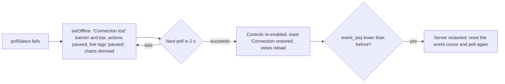

1. `setOffline(true)` shows a bar at the top of the main column (sticky on desktop; on phones the sticky top bar already says "Offline, reconnecting") with the attempt count. It never covers the page.
2. The status banner turns neutral: "Connection lost. Showing data from 23:01:28. Actions are paused; retrying every 2 s." The live tags read "paused" and the charts and pipeline are dimmed.
3. Every control that sends a request (the demo, faults, release, add transaction, write a report, restore) is disabled and marked; on reconnect exactly those are re-enabled and the next status render sets their real state.
4. While offline the other pollers pause and switching views redraws from the last data instead of sending requests; only `/api/status` is retried every 2 s.

---

## System flows

### S1. Startup

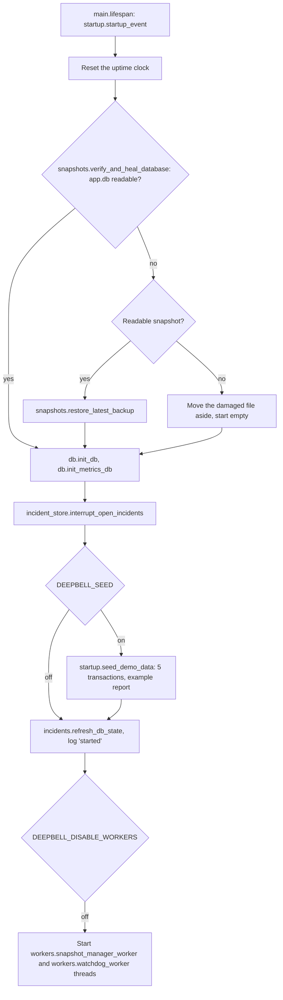

The database is checked before its schema is touched, because `db.init_db()` raises on a corrupted file and would crash every restart. The watchdog thread seeds 60 synthetic warm-up samples (`telemetry.seed_warmup_metrics`) unless live samples from the last 5 minutes exist.

### S2. Sampling and anomaly detection

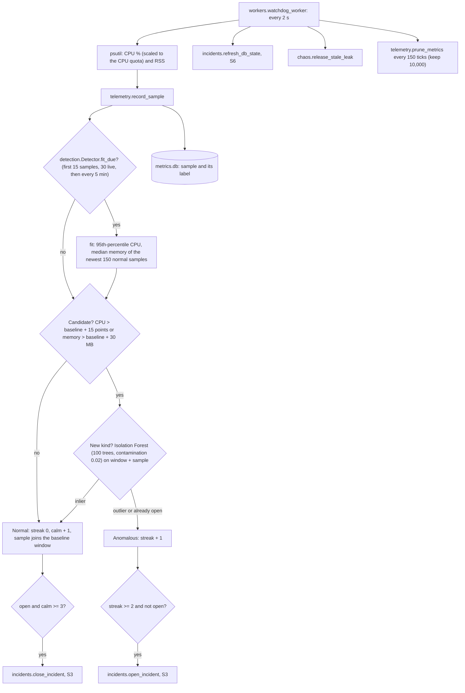

Files and functions: `detection.Detector` (`fit_due`, `fit`, `classify`, `isolated`, `observe`), `telemetry.record_sample`, `telemetry.sample_status`, `workers.watchdog_worker`. While an incident is open its samples never enter the baseline, so a held leak cannot become the new normal. Errors inside a tick are logged and the loop continues.

### S3. Incident lifecycle and timeline

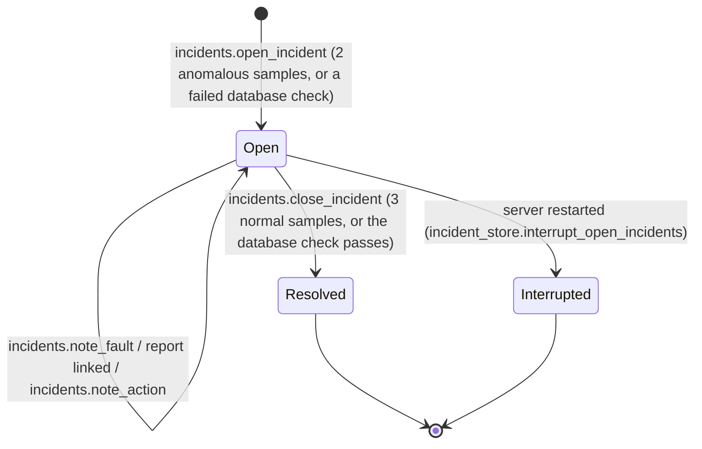

- Start time (`incidents.incident_start`): the Chaos Lab or demo fault that caused it if one was injected in the last 60 s (`runtime.pending_faults`), else the first anomalous sample of the streak (`runtime.first_flagged`).
- `incidents.open_incident()` inserts the row into `metrics.db` (`incident_store.insert_incident`, newest 100 kept), adds it to `runtime.open_incidents` (one per kind, so faults are de-duplicated), logs the event and starts a report (S4).
- `incident_store.update_incident()` appends timeline events under `runtime.incident_lock`; `incident_store.bump_incidents_rev()` tells pages to reload.
- Time to detect = detected minus started; time to recover = resolved minus detected (`incident_store.incident_from_row`). If writing history fails, detection carries on (the error is logged).
- Incident history lives in `metrics.db`, so corrupting or rolling back `app.db` never rewrites it.

### S4. Incident report generation

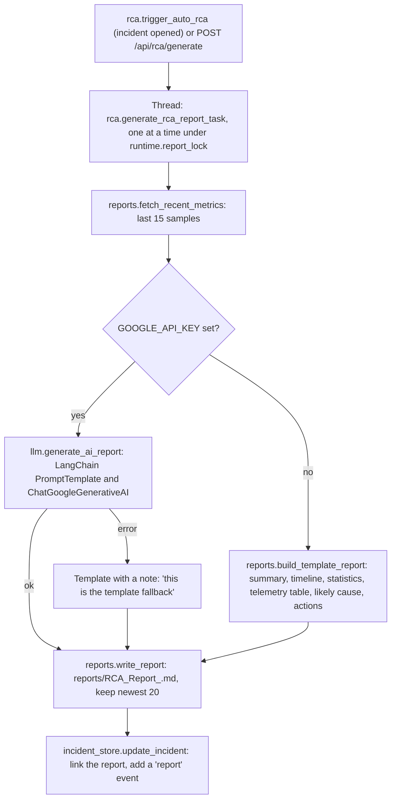

- The template's summary (`reports.report_summary`) counts only the samples of the incident's own kind: a CPU report ignores samples flagged for a memory leak, and a database report says the check failed, that CPU and memory are not part of the fault, and that any flagged samples in the window belong to another fault.
- The manual endpoint returns `busy` while a report is being written and 429 during its 30 s cooldown.
- `reports.report_source()` labels each report (Gemini, template, template fallback, example) from its text, so the page can say what wrote it.
- Any unexpected error is logged and the task returns an empty path; the incident stays open without a report link.

### S5. Snapshot worker

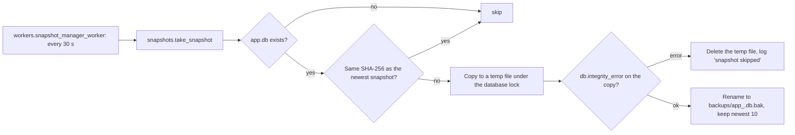

Snapshots are distinct restore points, each checked before it is kept; a torn read never becomes a snapshot. Because a snapshot is taken only when the data changed, `snapshots.latest_snapshot()` also reports whether the newest one is `current` (`snapshots.snapshot_is_current`: the SHA-256 of `app.db` equals the snapshot's), so the page can say "up to date" instead of making an old snapshot look like a failed backup.

### S6. Database health check and rollback

- `db.check_app_db()` runs `SELECT count(*) FROM transactions` under `runtime.db_file_lock` every 2 s (watchdog tick) and after every rollback or corruption.
- `incidents.set_db_error()` opens one `db_corruption` incident on the first error and closes it when the check passes again.
- `/transaction` and `/transactions` map SQLite errors to 503 with a recovery hint (`routes.transactions.database_unavailable`).
- `chaos.rollback_to()` copies the snapshot over `app.db` (`snapshots.restore_snapshot`), records the action on the open incident, logs it and re-checks the database. `routes.snapshots.post_rollback()` returns `success`, or `restored_with_errors` if the restored file still fails; an `OSError` becomes a 500 with the reason.

### S7. Guided demo scenario (server side)

`demo.run_demo_scenario()` runs the eight `config.DEMO_STEPS` in a thread, narrating each through `demo.demo_step()` (which `GET /api/status` and `GET /api/demo` return as `demo`):

1. ready: `demo.demo_get_ready()` waits for a baseline, no open incident and no held leak; after 15 s it clears leftovers; after 45 s it fails with the reason.
2. leak: `demo.demo_claim("leak", "memory_leak")` waits out another visitor's cooldown, then `incidents.note_fault` and `chaos.hold_leak(60)`.
3. detect: `demo.demo_wait()` polls until `runtime.open_incidents["memory_leak"]` exists and records the incident id and measured time to detect.
4. report: waits until the incident has a linked report.
5. release: `chaos.release_leak("Guided demo")`.
6. resolve: waits until the incident is resolved and records the time to recover.
7. corrupt: claims the corruption cooldown, `chaos.corrupt_database("Guided demo")`, waits for the database incident.
8. rollback: `snapshots.newest_good_snapshot()` and `chaos.rollback_to()`; the database incident resolves.

`demo.finish_demo()` stores the outcome and summary and starts the 20 s cooldown. `demo.DemoFailed` messages are shown to the visitor; unexpected errors are logged with a generic message. Pauses between steps (`config.DEMO_PAUSE_SEC`) keep it readable.

### S8. Live pipeline state

`overview.incident_pipeline()` builds the `pipeline` field of `GET /api/status`, which lights up the "How it works" steps:

| Stage | idle | active | waiting | done |
|---|---|---|---|---|
| Sample (`overview.sample_stage`) | no sample, or none for 6 s | sampling (or learning the baseline) | | |
| Detect (`overview.detect_stage`) | every sample within the baseline | a fault injected N s ago, waiting for 2 anomalous samples (`overview.pending_fault`); N of 2 anomalous samples in a row; "opening an incident" for the instant the streak is full | | incident opened, with its time to detect |
| Report (`overview.report_stage`) | no incident | writing | | report linked |
| Recover (`overview.recover_stage`) | nothing to recover | N of 3 normal samples; or "the guided demo releases / rolls back next" (`overview.demo_will`) | release the leak / restore a snapshot | resolved, with its time to recover |

The pipeline follows the open incident (`overview.pipeline_focus`), or one resolved in the last 60 s, but only until something new starts: a streak of anomalous samples, or a fault injected after it resolved, hands the pipeline back to detection at once. `current` is the first stage after Sample that is active or waiting; the page marks it "now", or "act now" when the visitor has to act. A screen reader hears each stage that changes state (U11).

### S9. Status polling, events, status strip and KPIs

- `routes.status.get_system_status()` returns health, open incidents, the last sample and when it was taken, the baseline, runtime.detector streaks, the database state, fault cooldowns, the demo, the pipeline, the newest snapshot (and whether it is current), uptime and, with `events_after`, the events newer than that cursor (`eventlog.recent_events`, newest 100 kept in memory).
- The page polls it one request at a time (`pollStatus`), so an action's refresh and the scheduled poll never render the same events twice; a new `last_sample_at` triggers `GET /api/metrics` (at most `config.METRICS_PAGE_MAX` = 400 samples per call).
- `overview.status_history()` (`GET /api/status/history`, minutes clamped to 5 to 120 and bars to 10 to 120) buckets the metrics into bars: incident, degraded (flagged, no incident), healthy, synthetic or no data, plus the share of healthy live samples.
- `overview.incident_stats()` (`GET /api/incidents/stats`) returns total and open counts, the median time to detect and to recover over the newest 20 incidents, and each one's times for the small bar charts.

### S10. Supervisor restart loop

`run_all.py` starts `uvicorn main:app` from `target_app/` and waits. A clean exit (code 0) stops the loop; any other exit code restarts the server after 2 s, and the new process runs the startup checks (S1). Ctrl+C stops both. The Docker image runs uvicorn directly with a single worker, because all state lives in one process.

### S11. Public demo safety: caps and cooldowns

| Guard | Where | Behaviour |
|---|---|---|
| CPU spike 1 to 5 s | `routes.chaos.inject_cpu_spike` | 400 outside the range |
| Leak 1 to 60 MB a step, 120 MB held | `routes.chaos.inject_memory_leak` | 400 / 409 "Release it first" |
| Leak auto-release after 5 min | `chaos.release_stale_leak` | freed on the watchdog tick |
| Shared 20 s cooldown per fault, 30 s for reports, 20 s after a demo run | `chaos.claim_fault`, `chaos.cooldown_left` | 429 with `Retry-After` and a readable message |
| One guided demo at a time | `routes.demo.post_demo_start` | 409 while one runs |
| `PUBLIC_DEMO=1` | `config` import, `routes.settings.post_save_apikey`, `routes.chaos.inject_fatal_crash` | no `.env` read, key endpoint and crash return 403, Settings hidden |
| Safe names only | `routes.reports.checked_report_name`, `config.BACKUP_NAME_RE` | 400 for anything else, so no path traversal |
| Reports cannot run script | `initMarkdown` in `app.js` | raw HTML escaped, links limited to http(s) and mailto, images dropped |
