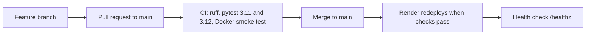

# Software development lifecycle: DeepBell

DeepBell is a small SRE lab in FastAPI. It samples its own CPU and memory, flags anomalies, writes incident reports and restores SQLite snapshots ([README](../README.md)). It was built by one author, Chandana Vishnu Jayanth, in short iterations. Early work went straight to `main`. From 2026-10-23 onward, changes went through small branches merged to `main` by pull request. The first commit is dated 2026-06-04 and the latest 2026-11-09. `git rev-list --count HEAD` gives 47 commits. There are 11 merge commits (pull requests #3 to #13). Pull request #1 appears in a commit title as a squash merge.

## 1. Planning and requirements

The original requirements are in [major_project_proposal.md](major_project_proposal.md). It states the problem: static-threshold monitoring only alerts, so recovery time is long and root causes need manual log reading. The target users are SRE-minded engineers and the project's examiners. The proposal fixes four modules:

- A FastAPI and SQLite target app with fault injection (CPU spike, memory leak, fatal exception).
- A rolling point-in-time snapshot engine.
- An ML watchdog using psutil and an Isolation Forest.
- A LangChain responder that rolls back and writes a root cause report with an LLM.

Its deliverables are a working monitoring agent, an automated recovery demonstration, generated reports and a GitHub repository. It names no numeric non-functional targets.

The delivered project differs from the proposal in these ways:

- It adds a public demo with caps and cooldowns ([README](../README.md), "Live demo").
- It adds a template report used when no Gemini key is set.
- It adds a Prometheus endpoint, alert rules and incident correlation, which the [roadmap](roadmap.md) records.
- It leaves out three things the proposal lists: log parsing, I/O telemetry and pandas. No Python file in the repo parses logs or samples disk I/O, and `pandas` is not in [requirements.txt](../target_app/requirements.txt).

Out of scope, per the [roadmap](roadmap.md): OpenTelemetry tracing (dropped), monitoring other Render demos (deferred), and anything that needs a paid service, a database server or a second always-on process.

## 2. Design

The backend is one FastAPI process with one uvicorn worker. The watchdog thread, snapshot thread, open incidents and Chaos Lab state all live in that process ([Dockerfile](../Dockerfile) comments). The code is split into a `deepbell` package with one module per job: detection, incidents, snapshots, chaos, demo, alert rules, correlation, and a `routes/` folder. See [target_app/deepbell](../target_app/deepbell/). The UI is a Jinja2 template with static JavaScript.

Storage is SQLite. Incident history lives in `metrics.db`, separate from `app.db`, so corrupting or rolling back the application database does not rewrite it ([README](../README.md)). Snapshots are copies of `app.db`, taken every 30 s when the contents change. The newest 10 are kept, each integrity-checked.

Design decisions the docs record:

- The roadmap explains why tracing was dropped and why other demos are not monitored (free-plan limits).
- Alert rules live in a versioned file, [alert_rules.json](../target_app/alert_rules.json).
- Likely cause is a labelled heuristic, not a claim of certainty.

Every user and system flow, with the functions involved, is in [process-flows.md](process-flows.md). Feature walkthroughs are in [docs/walkthroughs](walkthroughs/).

## 3. Implementation

- **Stack:** Python 3.11 and 3.12. Runtime pins in [requirements.txt](../target_app/requirements.txt): fastapi 0.162.2, uvicorn 0.54.0, jinja2 3.1.6, psutil 7.2.2, numpy 2.4.6, scikit-learn 1.9.1, langchain-core 1.7.6, langchain-google-genai 4.4.3, python-dotenv 1.2.4, python-multipart 0.0.33, prometheus-client 0.26.0. On 2026-11-09 these had 0 known advisories on OSV.dev.
- **Dev tools:** [requirements-dev.txt](../requirements-dev.txt) pins pytest 9.1.1, pytest-cov 7.1.0, httpx 0.27.2, ruff 0.6.9 and pyyaml 6.0.3.
- **Layout:** `target_app/` holds the app, `tests/` the tests, `monitoring/` the Prometheus and Grafana stack, `docs/` the documents. `run_all.py` is the local entry point. `reports/` holds generated sample incident reports.
- **Standards:** ruff checks and formats, configured in [pyproject.toml](../pyproject.toml) (line length 100, rules E, F, W, I, B, UP). CI enforces both.
- **Workflow:** the history has 18 commits before pull request #1, made directly on `main`. The module split of a 2,700-line `main.py` was done on 2026-11-01. Merged branch names from the merge messages: add-mit-license, readme-license, readme-case-study, fix/functionality, feat/prometheus-grafana, feat/alert-rules, feat/incident-correlation, test-temp-cleanup, proofread, upgrade-pytest, ground-ai-report. Some commits after #1 and before #3 (2026-10-31, 2026-11-01) were also made directly on `main`.

## 4. Testing

`pytest --collect-only -q` (run in `.venv`) collects 144 tests. The grouping below is by test file, so each level is a judgement based on the [README](../README.md) test section and the file names.

| Level | What it covers | Where | Count |
|---|---|---|---|
| Unit | Watchdog, detector, snapshots, rollback | [test_watchdog.py](../tests/test_watchdog.py) | 15 |
| Unit | Alert rules, states, webhook limits (fake clock) | [test_alerts.py](../tests/test_alerts.py) | 28 |
| Unit | Likely-cause rules and merged timeline | [test_correlation.py](../tests/test_correlation.py) | 15 |
| API | Endpoints, report wording, guided demo run end to end | [test_app.py](../tests/test_app.py) | 37 |
| API and end-to-end | Console features, pipeline through an incident | [test_features.py](../tests/test_features.py), [test_console.py](../tests/test_console.py) | 20 + 19 |
| API | `/metrics` output | [test_metrics.py](../tests/test_metrics.py) | 5 |
| Monitoring config | Prometheus and Grafana files | [test_monitoring_files.py](../tests/test_monitoring_files.py) | 4 |
| CI only | Container smoke test in public demo mode | [ci.yml](../.github/workflows/ci.yml) | 4 curl checks |
| CI only | `ruff check` and `ruff format --check` | [ci.yml](../.github/workflows/ci.yml) | not counted |

Tests use temporary directories, stub Gemini and disable or fake the background threads ([README](../README.md)). Faults are injected in the end-to-end tests, which the [roadmap](roadmap.md) says each new feature adds. The counts above are per file, so those tests are not counted separately. CI runs the suite on Python 3.11 and 3.12 with `pytest --cov=target_app --cov-report=term-missing`. It reports coverage but sets no minimum.

Not tested: there is no user acceptance testing and no browser-driven test (no Selenium, Playwright or Cypress in the dev requirements or the CI workflow). The front-end JavaScript has no automated tests.

## 5. Deployment

The [Dockerfile](../Dockerfile) builds from `python:3.11-slim`, installs the pinned requirements, runs as an unprivileged user and starts one uvicorn worker on `$PORT`. [render.yaml](../render.yaml) deploys it to Render's free plan in Singapore, with `healthCheckPath: /healthz`, `autoDeployTrigger: checksPass` and `PUBLIC_DEMO=1`. The disk is ephemeral and the app seeds itself on startup. The live demo is stated as [deepbell.onrender.com](https://deepbell.onrender.com).

There is one environment: production. No staging or UAT environment is defined.

## 6. Operations and maintenance

- **Monitoring:** the app exposes `/metrics`. [prometheus.yml](../monitoring/prometheus.yml) scrapes it every 5 s. [docker-compose.yml](../monitoring/docker-compose.yml) starts Prometheus and Grafana with a provisioned dashboard, [deepbell.json](../monitoring/grafana/dashboards/deepbell.json). This stack is for local use. The README does not say it runs for the live demo.
- **Alerting:** in-app rules from `alert_rules.json`, with a pending, firing and resolved lifecycle, an Alerts view and optional webhooks ([walkthrough](walkthroughs/02-alert-rules.md)).
- **Health checks:** `/healthz`, used by Render and by CI.
- **Dependencies:** all pinned exactly. The last recorded update is pytest 9.1.1 and pytest-cov 7.1.0 (2026-11-07). No automated update tool is configured in the repo.
- **Roadmap:** [roadmap.md](roadmap.md) lists three features, all now merged, and what is not planned.

## 7. Gaps and next steps

- **No UAT.** Nobody outside the author is recorded as having tested it. Next step: test the main tasks with three to five people and note where they get stuck.
- **No browser-driven tests.** Front-end code is untested. Next step: add a Playwright smoke test of the guided demo.
- **No staging environment.** Merges to `main` deploy straight to the demo. Next step: add a second Render service from a branch.
- **Single author, so no peer review.** Pull requests are self-merged. Next step: ask a reviewer to approve changes, or enable branch protection.
- **Some work went directly to `main`.** Next step: require pull requests on `main`.
- **No coverage threshold.** Next step: set `--cov-fail-under` in CI.
- **Pins age.** The runtime pins were upgraded on 2026-11-09 (0 OSV advisories) but are exact, so they will age again. Next step: add Dependabot.
- **Monitoring stack is local only.** Next step: say so in the README, or host it.
